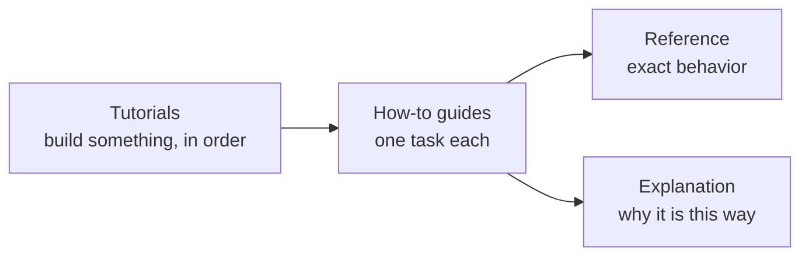

# VALANCE documentation

> **TL;DR:** VALANCE builds an interactive application whose state lives in one place, whose screen is a function of that state, and whose only way to change anything is a command. Start with the first tutorial; come back here when you need something specific.

## Prerequisites

* Node.js and a package manager (pnpm, npm or yarn).
* Some TypeScript. Nothing about the engines underneath is needed.

---

## Where to go

| You want to… | Read | Start with |
|---|---|---|
| learn by building | [Tutorials](tutorials/README.md) | [Your first application](tutorials/01-first-application.md) |
| get one thing done | [How-to guides](how-to/README.md) | [Async work](how-to/async-work.md) |
| look up exactly what an API does | [Reference](reference/README.md) | [API reference](reference/api.md) |
| understand why it works this way | [Explanation](explanation/README.md) | [What is VALANCE?](explanation/what-is-valance.md) |

## Common questions

| I want to… | Go to |
|---|---|
| build the smallest working application | [Your first application](tutorials/01-first-application.md) |
| see how state, components and events fit together | [State, components and events](tutorials/02-state-views-and-events.md) |
| run the application in a window | [Your first desktop application](tutorials/03-desktop-application.md) |
| wait for data, cancel it, or show loading and failure | [Async work](how-to/async-work.md) |
| draw the application, hydrate server HTML, or render on a server | [Mounting and hydration](how-to/mounting-and-hydration.md) |
| do a common task (add a page, a component, state, a command, a target) | [Common tasks](tutorials/README.md#common-tasks) |
| embed the engine in a page of your own, without `vlx` | [Without `vlx`](how-to/without-vlx.md) |
| know what VALANCE guarantees, and what it does not | [The V1 contract](reference/v1-contract.md) |
| install it, with the right package versions | [Installation](reference/v1-contract.md#13-installation-and-package-surface) |
| see what changed in a release | [Changelog](../CHANGELOG.md) |
| see a whole, runnable application | [`examples/todo-multi`](../examples/todo-multi) |

<b>For maintainers: design rules, evidence and direction</b>

* [Design north star](explanation/design-north-star.md) and its [scorecard](explanation/north-star-scorecard.md), with the [baseline](explanation/north-star-validation-2026-10-19.md) and [latest measurement](explanation/north-star-validation-2026-10-25.md).
* [Concept → evidence](explanation/README.md#from-a-concept-to-its-evidence): the investigation record behind each part of the contract.
* [Direction](explanation/direction/README.md): where VALANCE is heading, what is not built yet, and how to help.
* [Contributing](../CONTRIBUTING.md): building, testing and releasing.

## Next steps

* [Your first application](tutorials/01-first-application.md): `vlx init`, a page, state and a command, from nothing to a built site.
